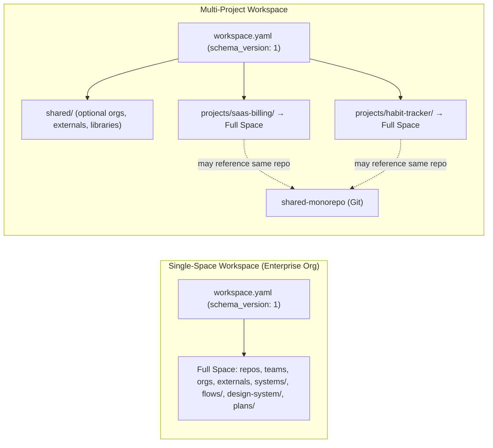

# Groundwork — Architecture & Schema Specification (v4)

> **Goal:** An agent-driven development framework (schemas, CLI/scanner, agent skills, and a local interactive React + Vite web UI) that maps existing systems and plans new work at any scale — bringing humans along visually so they can inspect, steer, and execute large-scale changes at speed and quality.

---

## 1. Core Principles

1. **One fact, one home (derived on read):** Every entity, contract, screen, store record, topic message, procedure, and handler is declared once in its natural folder. Edges, callers, producers/consumers, service roles, and gaps are derived on read — never duplicated.
2. **Code-first citations with rot detection, doc-aware, explicit unknowns:**
   - **`code`**: pinned `<home>:<path>#L<a>-<b> [symbol]` (commit from `evidence/<repo>/repository.json`) + generated sidecar content hashes so rescans detect `unchanged` / `moved` (auto-fixed) / `changed` (re-read required) **per fact**.
   - **`evidence`**: `evidence:<repo>/<id>` pointing to a persisted scan record.
   - **`doc`**: external documentation / API spec (`url`, `title`, `section?`, `version?`, `retrieved_at`) for 3rd parties without source access.
   - **`catalog`**: internal catalog or infra snapshot (`source`, `ref`, `snapshot_at`, `digest`) for Backstage, K8s/Helm, Terraform, or OpenAPI registries.
   - Unknowns are never guessed or hidden — they are typed, counted gaps (`known_from`, `unresolved_call`, `owner: unknown`).
3. **Mechanically accounted completeness on 3 separate axes:**
   - Never collapse **Accounted Coverage**, **Freshness**, and **Depth** into one binary verdict.
   - Close at **3 levels**: Space repo list → package roots per repo → surfaces per component.
   - Cross-check independent denominators (declarative specs vs. AST) where both exist; allow pattern-rule triage (`/actuator/**`) and explicit `contract-only` depth.
4. **Isolated Fractal Spaces — solo project to 100-repo enterprise:**
   - Every **Space** (a standalone enterprise org OR a project inside a multi-project workspace) has the exact same full schema (`repos`, `teams`, `actors`, `organisations`, `externals`, `libraries`, `domains`, `systems`, `flows`, `design-system`, `plans`, `programmes`).
   - Projects in a multi-project workspace are **strictly isolated Spaces** (no cross-project `::` IDs), but **two projects may reference the same repository** independently.
5. **Plans = 4 Native Pillars + Reconciliation-Based Landing:**
   - New systems/services (greenfield or hybrid) live in `architecture/additions/` as normal System Map files; edits to existing systems use **surgical tree-aware ops** (never 260-line handler copy-pastes).
   - **Landing is reconciliation per change** against a fresh scan (`landed_as_planned` | `landed_differently` | `not_found`) — code remains the source of truth.
   - Count-based maturity gates are paired with **named human sign-off per pillar**.
6. **Bi-directional Human–Agent UI:** Humans inspect blast radius, live sandboxed prototypes with **Architecture X-Ray**, and execution DAGs — and pin one-file-per-note **review annotations** (`reviews/<id>.yaml`) back to the agent.

---

## 2. Pillar 1 — Workspaces & Fractal Spaces

Clone Groundwork and configure workspaces via pointer manifests under `workspaces/` (git-ignored in Groundwork, except `examples/`):

```text
groundwork/
  workspaces/
    personal.yaml                # points to your personal workspace git repo (root: ../my-personal-groundwork)
    acme-org.yaml                # points to your company workspace git repo (root: ../acme-groundwork)
```

- **Every workspace is its own Git repo** (so plans always have real Git revision history and PR review). `groundwork workspace init <path>` initializes a workspace repo, copies the pinned Groundwork skills into it (no cross-machine symlinks), and writes the pointer file in `workspaces/<name>.yaml`.
- **Single-Space vs. Multi-Project Workspace:**
  - **Single-Space (`workspace.yaml`):** The repo root *is* a Space (`repos`, `domains.yaml`, `systems/`, `externals/`, `design-system/`, `flows/`, `plans/`, `programmes/`).
  - **Multi-Project (`workspace.yaml` with `projects:`):** Holds multiple isolated Spaces under `projects/<project>/project.yaml`, plus optional workspace-level `shared/` (`organisations`, `externals`, `libraries`). Projects never reference other projects, but two projects can freely point to the same underlying Git repository in their `repos:` map.



- **Enterprise primitives included natively (all optional):** `organisations` with `direct | product | indirect` relationships, partner `teams` (`organisation:` + `contacts:`), `language.yaml` (ubiquitous glossary anchored to IDs), `landscape.yaml` (curated views separate from ownership), `graphs/<graph>.yaml` (federated GraphQL), `flows/` & `journeys/`, and `programmes/`.

---

## 3. Pillar 2 — System Map

### Canonical Full-Prefix Pathed IDs (100% Greppable, Component-Scoped)

- **Every reference is canonical** (no `./` or `../` shorthand in references — `grep` always finds every usage). Bare local slugs are allowed **only** on `id:` at declaration.
- **IDs path by component, not domain or system:** Moving a system between domains (or a service between systems) rewrites **zero** references. `groundwork id move <old> <new>` performs one atomic rewrite across model, plans, review notes, and prototype bindings; `aliases.yaml` serves external links only.

| Kind | Canonical ID Example | Child Address Example |
| :--- | :--- | :--- |
| Space / Domain / System | `domain:checkout`, `system:orders` | — |
| Components | `service:orders-api`, `app:checkout-web`, `store:orders-db`, `topic:order-events` | — |
| Contracts | `interface:orders-api/admin-v1`, `endpoint:orders-api/create-order`, `message:order-events/order-created`, `subscription:orders-worker/on-payment`, `job:orders-api/outbox-relay`, `interaction:checkout-web/submit-order` | — |
| Schemas & Screens | `schema:orders-db/order-record`, `schema:orders-api/create-order-request`, `screen:checkout-web/summary` | `schema:orders-db/order-record#reserve-until`, `screen:checkout-web/summary#pay-bar` |
| Behavior | `handler:orders-api/create-order`, `procedure:orders-api/validate-stock`, `flow:place-stock-order` | `handler:orders-api/create-order#reserve-car`, `...#!out-of-stock` |
| External / Shared | `external:stripe`, `endpoint:stripe/create-payment-intent`, `library:acme-messaging`, `team:checkout`, `actor:customer`, `organisation:stripe` | — |
| Planning | `plan:stock-reservation`, `change:stock-reservation/reserve-at-checkout`, `requirement:...`, `milestone:...`, `work-item:...`, `test:...`, `decision:...`, `question:...`, `risk:...` | — |

### Single Canonical File Layout (Component-Centric)

One layout for every Space — `domain:` is a field in `system.yaml` (not a nested directory):

```text
<space>/
  workspace.yaml (or project.yaml)
  domains.yaml                   # optional domain definitions (id, name, purpose)
  language.yaml                  # optional business glossary
  landscape.yaml                 # optional curated area / value-flow views
  externals/
    stripe/
      external.yaml              # vendor identity, organisation, doc root
      contracts.yaml             # ONE canonical home for 3rd-party endpoints (known_from: vendor-doc)
  unassigned/
    stores/<store>.yaml          # stores/topics with owner: unknown (explicitly counted gap)
    topics/<topic>.yaml
  design-system/                 # Space-level design system (code-cited for brownfield or authored for greenfield)
    system.yaml
    tokens.json                  # W3C DTCG tokens (or `source: code:` citation for brownfield)
    components/
  graphs/<graph>.yaml            # optional federated GraphQL supergraphs
  flows/<flow>.yaml              # first-class cross-system Data Movement flows (referencing handler steps)
  systems/<sys>/
    system.yaml                  # id, domain?, team?, mapped: true|false, homes (repo+subpath), runs_on, connections
    contracts.yaml               # ONLY for mapped: false stub systems (known_from: consumer-observed | declared-spec)
    components/<comp>/
      component.yaml             # id, kind, tech, home, summary, cites, triage (incl. pattern rules), attestations, observed_edges
      contracts.yaml             # interfaces (base_path, auth, known_from), subscriptions, jobs, local DTOs
      screens.yaml               # screens, regions, interactions (for apps)
      handlers.yaml              # handlers + reusable procedures (or handlers/<id>.yaml when a handler is large)
    stores/<store>.yaml          # store metadata, owner (or unknown), AND its record schemas (tables/collections)
    topics/<topic>.yaml          # topic/queue metadata, owner (or unknown), AND its message payload contracts
  evidence/<repo>/
    repository.json              # git commit pin, scan timestamp, extractor capability table (framework + version)
    inventory.json               # compact sorted surface inventory (committed; raw caches stay git-ignored in .groundwork/)
    cite-anchors.json            # generated symbol + content hashes for per-fact citation rot detection
```

### Contracts, Handlers & Reusable Procedures

- **`known_from:` on every contract:** `implementation` (handler required unless depth is `contract-only`), `declared-spec` (OpenAPI/SDL/Proto), `consumer-observed` (cited from caller code on a `mapped: false` stub system), or `vendor-doc` (`doc:` citation with `retrieved_at`).
- **Complete Handler & Procedure Grammar:**
  - `procedure:` defines a named, cited sub-flow invoked via `run: procedure:<comp>/<name>` (eliminates 38k-line inlined handlers).
  - Step effects: `read`+`from`, `write`+`to`, `call` (resolved `endpoint:`/`operation:` OR typed `unresolved_call: { target_hint, gap_id }`), `publish`, `run` (`procedure:`), `wait`, `return`.
  - Control structures: `if`/`then`/`else`, `dispatch` (key → `procedure:`), `each`/`steps`, `parallel` (named lanes), `try`/`catch`/`finally`, `transaction`/`steps`, `retry` (`until`/`times`/`exhausted`).
  - Modifiers: `when`, `async`, `causes`, `say` (≤60 chars), `does`, `cites` (using `cite_base:` on handlers/procedures to avoid repeating file paths).
  - Step IDs are short, semantic, and unique within their owning handler or procedure.

### 3-Axis Mechanically Accounted Completeness

`groundwork check` reports **3 separate axes** per component, system, and Space — never one collapsed verdict:

1. **Accounted Coverage (3-level closure):**
   - Level 1: Every repo in the Space's repo list is claimed (or explicitly triaged).
   - Level 2: Every package/app root in a monorepo is claimed by a component `home` (or triaged).
   - Level 3: Every surface in `inventory.json` (cross-checking declarative specs against AST where both exist; disagreement = explicit finding) is **bound** to a model entity or matched by a **typed triage rule** (exact or glob pattern like `route:*:/actuator/**` → `operational | dead_code | test_only | deferred`).
   - Reported as a per-facet ledger: `{ found, bound, triaged, deferred, denominator_source, extractor_support }`. `supported` is granted per detected framework + version backed by recall fixtures; unsupported facets require file-cited `attestations`.
2. **Per-Fact Freshness:**
   - On rescan, `cite-anchors.json` re-anchors each citation by symbol + content hash → `unchanged`, `moved` (auto-fixed line range), or `changed` (fact flagged stale for re-read).
3. **Modeling Depth:**
   - Explicit per component: `stub` (`mapped: false`) → `contract-only` (APIs/stores/topics captured, handlers not yet traced) → `full` (every `implementation` entry has a cited handler, 0 unpromoted `observed_edges`).

---

## 4. Pillar 3 — Plans (4 Native Pillars + Reconciliation Landing)

```text
plans/<plan>/
  plan.yaml                      # manifest: meta, builds_on, problem, pillar declarations, signoffs, questions, decisions, risks
  architecture/
    additions/                   # NEW systems/services/flows (greenfield or hybrid) in standard System Map layout
      systems/<new-sys>/...
      flows/<new-flow>.yaml
    changes.yaml                 # surgical tree-aware ops on existing entities + relies_on (unchanged dependencies)
    .base-lock.json              # entity/step hashes for both modified targets AND relies_on targets
    notes.md
  design/
    design.yaml                  # design_system (inherit|extend|new|code-cited), flows, screen/region prototypes, fidelity, states, a11y, bindings
    tokens.patch.json            # optional W3C DTCG token additions/overrides
    prototypes/                  # sandboxed HTML+CSS+JS (screen- or region-scoped over baseline screenshot/render)
    components/
    assets/                      # baseline screenshots, Figma links, diagrams
  execution/
    execution.yaml               # milestones, work items, DAG depends_on, target (repo|new_repo|external), external_ref, traceability
    progress.yaml                # append-only status & partner commitment log (who, when, source_url, status)
  proof/
    proof.yaml                   # high-level tests (unit|contract|service|integration|e2e|manual), Given/When/Then, cites
  discovery/                     # optional discovery notes & raw findings
  reviews/
    <note-id>.yaml               # one file per UI/human review note (avoids UI vs. agent write conflicts)
```

### Key Plan Mechanics

1. **Surgical Tree-Aware Ops + `additions/` + `flow:`:**
   - Brand-new systems, components, and flows live as normal System Map files under `architecture/additions/`.
   - Edits to existing entities use `add`, `modify`, `remove`, `insert_step` (`into`, `branch: steps|then|else|try|catch`, `before`/`after`), and `wrap_step`. Full-array `set: steps:` is banned unless `replace_all: true` + `reason:`.
   - `relies_on:` lists entities the plan depends on without modifying so `.base-lock.json` detects drift there too (`clean_apply` | `semantic_drift` | `hard_conflict`).
2. **Design Pillar (Brownfield-Ready & Strict Sandbox):**
   - Supports **region-scoped prototypes** over a captured baseline (screenshot or render from code) with explicit `fidelity: low | mid | high` — no rebuilding 443 screens from scratch.
   - Brownfield Spaces can cite their existing design system from code (`source: code:web-repo:packages/tokens/tokens.json`) instead of re-authoring it.
   - Prototypes run in `<iframe sandbox="allow-scripts">` with a **strict no-network CSP** (`default-src 'none'; style-src 'unsafe-inline'; script-src 'unsafe-inline'; img-src data: blob:`), auto-injected CSS variables, state toolbar (`data-gw-state`), flow navigation (`data-gw-goto`), and **Architecture X-Ray** (`data-gw-region`, `data-gw-endpoint`, `data-gw-schema`).
3. **Maturity Gates (`draft` → `ready` → `executing` → `landed`) + Named Human Sign-Off:**
   - `groundwork plan check --gate ready` enforces all 6 structural invariants (explicit pillar declaration, schema coverage on APIs/messages, Design bindings on touched screens, Execution DAG acyclicity + change/target coverage, Proof coverage on changes/requirements, greenfield parity) **AND** requires a **named human sign-off per pillar** in `plan.yaml` so count-based gates cannot be gamed with filler.
4. **Reconciliation-Based Landing (`groundwork plan land <plan>`):**
   - Landing does **not** blindly write uncited ops into the System Map. Instead, it runs per change against a fresh `groundwork scan` and reconciles each planned entity against scanned reality (`landed_as_planned` | `landed_differently` | `not_found`).
   - Plan status is derived from gates, progress, and reconciliation (only human approvals are stored). Landed parents are ignored at apply time rather than mutating child `builds_on` across branches.

---

## 5. Interactive Local Web UI (React + Vite + TypeScript)

Served via `groundwork serve` (Node incremental server-side index + file-watcher/SSE + React/Vite SPA):

- **`Cmd+K` Command Palette:** Instant fuzzy jump across services, endpoints, messages, schemas, flows, teams, partners, terms, and code file paths.
- **System Map Canvas:** `elkjs`-powered orthogonal layout with zoom/pan, progressive disclosure (Domains/Landscape → Systems → Components → Contracts → Entry Flow Canvas with `procedure:` drill-in), **1–2 hop Ego-Graph / Blast-Radius** isolation, **3-Axis Completeness & Per-Fact Freshness** overlays.
- **Plan Studio (Overview + 4 Pillar Tabs):**
  - **Overview:** Problem, risks, open questions/decisions, maturity gate checklist + per-pillar human sign-off status, blast radius.
  - **Architecture:** `Before` / `After` / `Diff` System Map + Data Movement (`flow:` & handler diffs), APIs, Data at Rest, Async Messages.
  - **Design:** Sandboxed no-network prototype player (screen or region-over-baseline) + state switcher + **Architecture X-Ray** + Design System token/component gallery.
  - **Execution:** Work Item DAG with critical path, ready-to-start wave filter, and Team / Partner / Repo / Milestone swimlanes + partner commitments.
  - **Proof:** Verification Matrix (`Changes & Requirements` × `Tests`) with Given/When/Then and code-citation status.
- **Inline Review Notes:** Pin comments on any entity/step/wireframe/work-item ID → written as `reviews/<note-id>.yaml` with anchor hash and status (`open` | `resolved`) for agents to pick up cleanly.

---

## 6. Monorepo Structure & Phased Build Plan (`npm` workspaces, Node 24)

```text
groundwork/
  packages/
    schema/      # JSON Schemas (Ajv) + generated TypeScript types
    core/        # Incremental per-file-cached model loader, copy-on-write plan apply, index, 3-axis completeness & maturity gates
    scanner/     # 2-stage scanner (pins, declarative specs, AST candidates, capability table, cite-anchors)
    cli/         # `groundwork` CLI + local incremental query API & SSE file-watcher server
    ui/          # React + Vite + TypeScript UI (elkjs canvas, Plan Studio, sandboxed Design player)
  skills/        # Agent skills (copied into workspace repos with pinned version)
  examples/
    personal/    # Multi-project workspace (2 isolated Spaces sharing a common repo)
    acme-org/    # Enterprise org workspace (domains, partner orgs, flows, design-system, stacked plans)
```

### Build Order (Risk-First)

- **Slice 0 — Real-World Validation Spike:** Build the minimal `packages/schema` core + prototype `packages/scanner` against 1 real repo (and validate the `procedure:` / `dispatch:` / `cite_base:` model against a complex handler) to prove completeness accounting and ergonomics before scaling up.
- **Slice 1 — Foundation (`schema` + `core` + `cli` + examples + 100-system benchmark fixture):** Full schemas, incremental per-file-cached `ModelIndex`, copy-on-write `applyPlan` + `.base-lock.json` drift, 3-axis completeness & maturity-gate validators, `groundwork workspace/map/plan/id` CLI, both examples, and a generated 100-system performance fixture.
- **Slice 2 — Interactive System Map UI (`ui` + `groundwork serve`):** Live-reloading server + React/Vite app with `Cmd+K` search, Workspace/Space switcher, `elkjs` System Map canvas (zoom/pan/expand/ego-graph), Contract Inspector, Entry Flow & Procedure viewer, and 3-axis Completeness/Freshness inspector.
- **Slice 3 — Plan Studio UI (4 Pillars + Review Notes):** `Before`/`After`/`Diff` Architecture + Flows, sandboxed no-network Design prototype player + Architecture X-Ray + Design System gallery, Execution DAG (critical path + swimlanes), Proof Matrix, and `reviews/<note-id>.yaml` inline annotations.
- **Slice 4 — Full 2-Stage Scanner & Agent Skills:** Expand `packages/scanner` extractors + recall fixtures + `cite-anchors` rot detection + the 6 agent skills (`workspace`, `scan`, `explore`, `plan`, `execute`, `review`), verified end-to-end.
