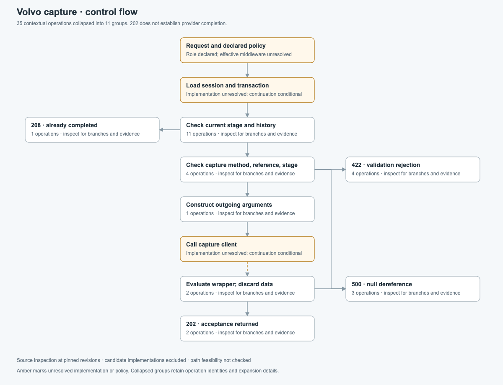
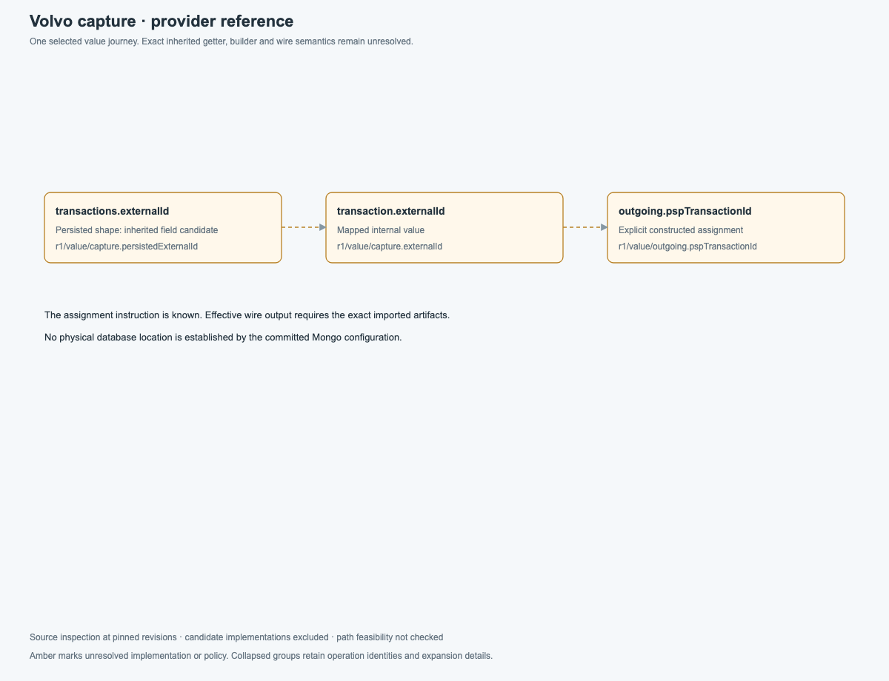

# Capture endpoint knowledge proof

The [v3 runtime walkthrough](../runtime-components.md) now opens this proof on components and interactions.
Select a component for its internal logic or a connection for its contract, schemas and GitHub sources.
Its upgraded inputs are under `runtime/`; the original bundle and manifest below are preserved for replay.
`index.html` is the new landing page; `logic.html` retains the original overview.

The [source-reviewed enrichment](../volvo-native-rescan/captures/payment-transaction-deep/README.md) and
[expanded explorer](../volvo-native-rescan/views/capture/runtime/index.html) supersede this fixture's local-module,
REST-wrapper and SDK-transport assumptions. The original proof commands continue to replay their original
inputs for regression; they do not select the latest enrichment. Original bundles/manifests remain unchanged.

The canonical execution model is a set of typed, revision-specific records selected by an immutable
snapshot. Endpoint explanations are queries over those records. The database and drawings are rebuildable
projections. This proof settles that execution core and its first query contracts; it does not migrate the
production workspace format or claim to finish the whole enterprise model.

The input is the [pinned Volvo capture analysis](../volvo-capture.md). This is static source inspection.
Existing Java tests were read, not executed. Imported shared/client versions remain unresolved. No endpoint,
Mongo instance or payment provider was invoked. All 37 evidence references retain their original commits and
line ranges, including separately labelled candidate and test-assertion evidence.

## Run and inspect

```sh
npm run generate:knowledge
npm run proof:capture
npm run proof:capture -- reports/capture-proof/outcome208.request.json
npm run proof:capture:sources -- /path/to/clones
npx vitest run --project unit tools/capture-proof.test.ts tools/knowledge-resolution.test.ts
```

The source check expects `clones/volvo-cars/<repo>`. It checks source existence and ranges, not semantics.
The proof command validates its input, checks the manifest and bundle digests, builds/reuses a disposable
SQLite index and validates every query response. A supplied request file produces JSON on stdout.

Generated files live in `reports/capture-proof/`:

- `index.html`, `control.svg`, `value.svg`: the two visual projections.
- `*.request.json`, `*.json`: eight executable requests and their auditable answers.
- `index.sqlite`: a disposable index, safe to rebuild from these inputs.

Screenshots were captured and inspected at 1200 × 920. The control drawing represents all 35 contextual
operations in 11 groups. The three-node provider-reference journey remains separate. Group placement is
specific to this proof; it is presentation configuration, never canonical fact data. The report is a static
inspection artifact, not a new application route or a general interactive explorer.

## Authority, identity and publication

[knowledge.schema.json](../../../schema/knowledge.schema.json) defines closed records, snapshot manifests,
requests and responses. Generated TypeScript is checked against that schema by a test.

`bundle.json` is a revision bundle. `snapshot.json` selects its SHA-256 digest and the query rule version.
The digest uses recursively sorted object keys, preserved array order and compact JSON encoding. Formatting
and property-order changes do not change identity; record ordering does. This is the proof's specified
encoding, not a claim of RFC 8785 compliance. A semantic change requires a new bundle digest and manifest.

Records have revision identities, scoped by their immutable bundle selection. Implementations and entries
also have stable `logicalId` values for continuity. References select revision records; a logical ID or label
never means "whichever implementation was scanned last". Duplicate record IDs across selected bundles are
rejected. Cross-bundle references are validated against the complete selection.

The serving index stores a bundle once and joins snapshot membership to it. Imports validate before a
transaction publishes membership and the manifest together. Existing snapshots are retained; invalid input
cannot replace them. Readers are pinned to one published snapshot. There is no mutable "current" pointer,
concurrent scan merge policy, partial-scan replacement or deletion protocol in this proof. Those require
additional ingestion contracts before production use. A knowledge snapshot does not establish a deployment.

## Canonical record decisions

| Records                                               | Meaning and constraint                                                                                                                                                                                                                            |
| ----------------------------------------------------- | ------------------------------------------------------------------------------------------------------------------------------------------------------------------------------------------------------------------------------------------------- |
| Source revisions, artifacts, artifact/source bindings | A source commit is separate from the artifact a caller imports. Exact cross-artifact traversal requires a digest and an exact binding.                                                                                                            |
| Resolutions                                           | Caller-owned, with a local-source target, verified artifact target, or null target plus explicit candidates. Local resolution cannot cross source revisions.                                                                                      |
| Entries and implementations                           | Reusable implementation definitions, parameters and entry operations. Endpoint details are composed from these definitions.                                                                                                                       |
| Operations and control transitions                    | Evaluation order, guards, normal exits and typed exceptional exits. Unsupported operations are retained as opaque boundaries.                                                                                                                     |
| Values and flows                                      | Particular definitions, field access paths and transformations, not globally identified variable names. Caller arguments, callee parameters and returned results bind in an invocation context.                                                   |
| Shapes                                                | Source, constructed, wire and persisted representations remain separate. Inheritance/default/serialisation uncertainty is not converted into a field default.                                                                                     |
| Effects and resources                                 | Explicit calls/reads/writes/publications, logical resource declarations and declared/traced source modality. Unknown callee effects are not an empty effect set.                                                                                  |
| Claims and evidence                                   | Assertions retain inputs, assumptions and source support. The extracted interpretation remains auditable rather than formally proved.                                                                                                             |
| Coverage and gaps                                     | Specific obligations and unresolved boundaries. An examined argument construction does not establish a complete wire body.                                                                                                                        |
| Derivations                                           | Reverse-indexed inputs for recomputation, separate from the citations displayed to the reader. Extraction and explanation dependencies are both represented. Endpoint invalidation is deliberately conservative across the inspected input scope. |

Invocation contexts are constructed during queries; the store does not persist an infinitely expanded call
graph. Revision-owned values, actual/formal bindings and stack-specific exception unwinding prevent shared
methods from mixing callers. Assignment or mutation creates a new value definition; unsupported aliasing
must be opaque. This proof tests definition separation but does not implement Java alias analysis.

The real fixture contains only source-local exact resolutions and unresolved dependency resolutions. The
positive verified-artifact acceptance case is explicitly synthetic. It does not resolve Volvo's missing
artifacts. Neither newer candidate source nor a newer scan changes an existing binding automatically.

This execution core has no team-owned technical identity or system/domain containment key. Components,
libraries, grouping/ownership overlays, reversible identity reconciliation, plans and runtime observations
need their own typed extensions and migration tests. They must preserve the reference and snapshot rules here.

## Query contracts

Every request pins a snapshot, an entry, a query kind and a node budget. `candidates: exclude` is the only
supported policy. Unsupported candidate exploration must not silently activate candidate implementations.
The schema rejects an outcome query without a status, a value query without a selected value, and arguments belonging to a different query kind.

| Query     | Result semantics                                                                                                                                                                      |
| --------- | ------------------------------------------------------------------------------------------------------------------------------------------------------------------------------------- |
| `trace`   | Contextual control graph. Unresolved calls are boundaries; any local normal continuation carries an explicit assumption.                                                              |
| `outcome` | Backward structural slice to a selected HTTP status. Irrelevant later boundaries are excluded. Guards are preserved; path feasibility is not established.                             |
| `value`   | Backward origins for a value in an explicit invocation context, including argument and return bindings. A different requested representation produces an unresolved mapping frontier. |
| `effects` | Effects attached to examined operations, with a scoped absence statement and unknown callee effects retained.                                                                         |
| `impact`  | Transitive invalidation of dependent explanations. It does not claim runtime incompatibility or identify every possible consumer.                                                     |

Responses include contextual nodes/edges, supporting typed records, claims, evidence, scoped coverage,
knowledge frontiers and query limits. Supporting records retain the connections between assertions and
citations. Expressions and flow transformations are preserved as source explanations; this format does not
yet contain a language-independent expression evaluator.

`traversalComplete` means the traversal did not hit its node budget. It does not mean knowledge is complete.
`exhaustive` is always false and `feasibility` is always `not_checked` in this version. Cycles, opaque operations,
unresolved versions, unresolved representations and query truncation remain distinct frontiers.

The v1 limit applies to contextual traversal nodes, not the full supporting-record closure or response bytes.
There is no cursor: rerun the pinned query with a larger budget, up to 2000 nodes. Production contracts must
add support-record/byte/time budgets and resumable traversal before exposing arbitrary large graph queries.

## What the real endpoint establishes

- Completion in current stage or history reaches the validator's exception and controller's 208 catch before
  the capture client. Earlier reads/mapping must return normally.
- Invalid non-null stage can produce 422. Null stage can fail while constructing that rejection and reach 500.
- A null client response wrapper can fail at `getData()` even though its result is discarded.
- The explicit provider-reference assignment links the internal external ID to `pspTransactionId`. Its
  inherited persistence/getter semantics and effective wire representation remain partial.
- The controller's normal continuation returns 202. No durable provider completion is established.
- No explicit local write appears in the examined operations. Unresolved effects prohibit a global no-write
  conclusion.

The fixture intentionally records a gap for other outcomes: request decoding, transaction-not-found 404,
middleware and other failures are not exhaustively encoded by this proof. Queries must not present its
selected outcome set as the endpoint's complete response catalogue.

## Acceptance and next gates

The [second proof](../soft-offer-proof/README.md) now tests a database write and Kafka continuation in C#.
It closes gates 1 and 2 below for these two cases and adds bounded supporting-record pages from gate 4.
The remaining ingestion, wider serving and performance gates still apply. The archived
[knowledge-v1 schema](../../../schema/knowledge-v1.schema.json) preserves this fixture and its original rules;
`knowledge.schema.json` is the current v2 extension.

The tests cover the real paths above, shared invocation/mutated-definition separation, return bindings,
newer candidate isolation, synthetic exact-version selection, cycles, opaque operations, query limits,
helper/configuration/dependency invalidation, bad references, digest mismatch, schema drift and database
rebuild equivalence. A failed import leaves a prior snapshot queryable.

This settles an executable static-analysis core and honest query semantics. Before workspace-wide adoption:

1. Extract a second endpoint with different branching, persistence and asynchronous behaviour; avoid
   generalising from one Java controller.
2. Implement explicit asynchronous causation, correlation, durable hand-off and delivery-policy records.
3. Implement ingestion replacement/deletion/merge rules and versioned human interpretation bundles.
4. Add bounded supporting evidence delivery, pagination and broader query contracts such as discovery,
   usage/compatibility and snapshot comparison.
5. Benchmark real Volvo plus larger fixtures with shared hubs and fan-out; measure cold/warm latency,
   transferred bytes, memory, first useful diagram and incremental invalidation. Current correctness tests
   and diagram screenshots do not establish enterprise-scale performance.

## Captured views




