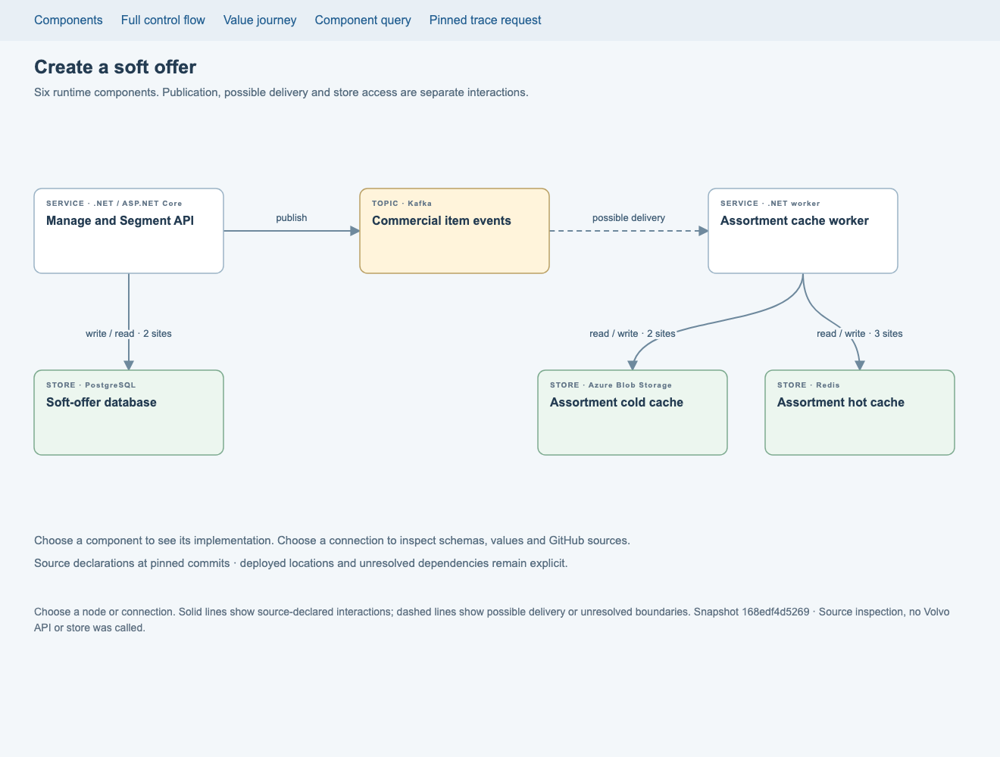
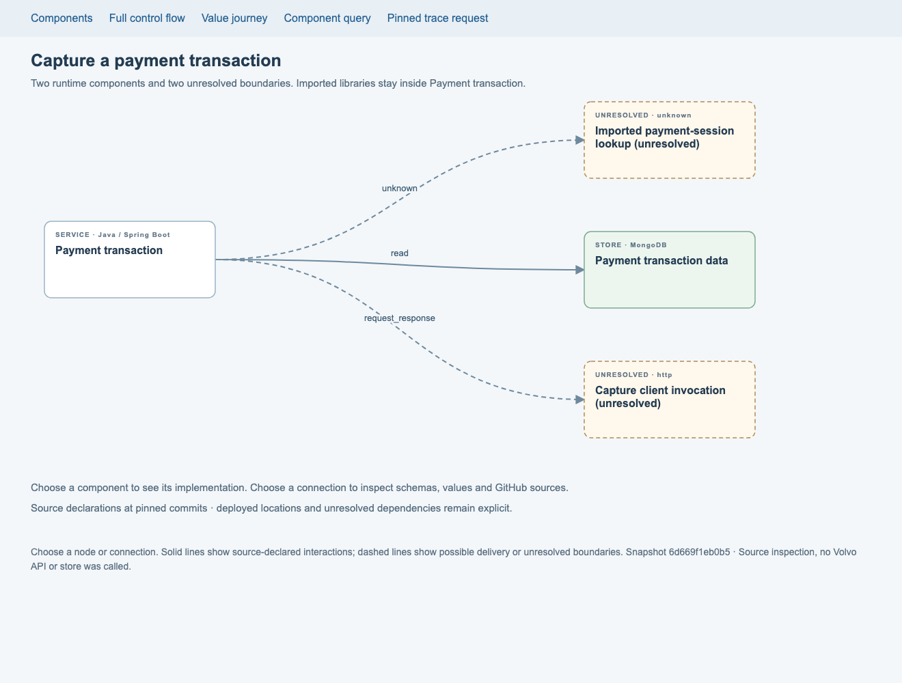
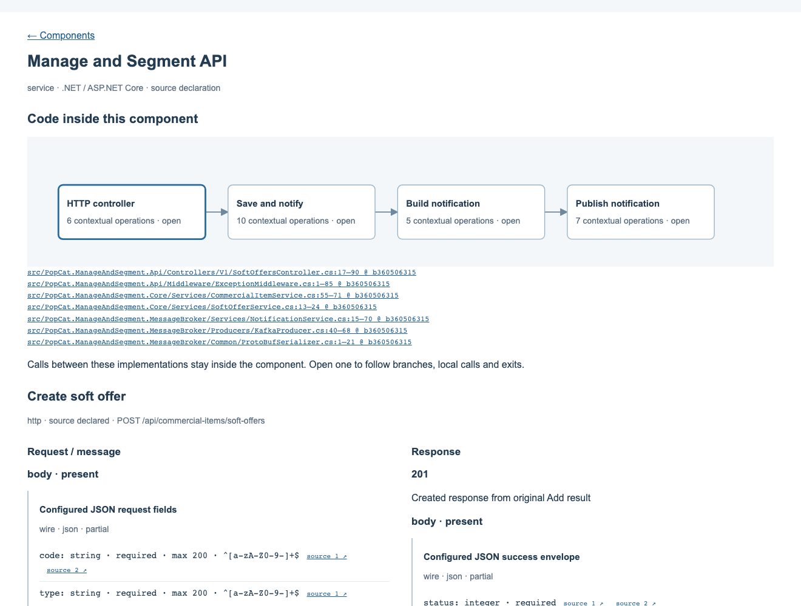
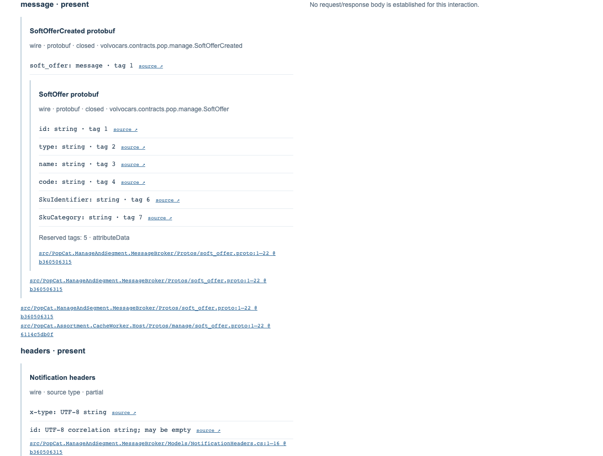

# Runtime components and interface contracts

The canonical execution schema is now v3. Runtime components, the code executing inside them and the
contracts crossing their boundaries are separate records. Both Volvo proofs now open on components and
interactions, with internal logic and source-backed schemas available by selection.

This is the next execution-model migration target. The production workspace loader and Next.js application
have not been migrated. The original capture v1 and soft-offer v2 bundles and manifests are unchanged and
continue to replay under their archived schemas and rules.

## What is native

| Record               | Meaning                                                                                                                                                                                                                                                                                                                               |
| -------------------- | ------------------------------------------------------------------------------------------------------------------------------------------------------------------------------------------------------------------------------------------------------------------------------------------------------------------------------------- |
| `runtime_component`  | A logical running component: service, app, store, topic or external boundary. Source declarations establish its identity, not its deployed instance. Team, system and domain groupings are not identity fields.                                                                                                                       |
| `execution_binding`  | An implementation runs inside a particular component. Several implementations can share a host, and reusable code can have explicit bindings to different hosts. Foreign library source requires an exact artefact/source binding and digest. A library is never made into a remote service merely because it has its own repository. |
| `resource_binding`   | A logical collection, table, topic, key or remote-interface resource belongs to a runtime component. Its role is storage, transport or remote interface; this permits calls to other services as well as stores.                                                                                                                      |
| `entry_binding`      | An inbound source entry is exposed by a particular host execution and interface contract. Protocol, method/address, implementation and host must agree; REST, gRPC and lifecycle entries retain their own rules.                                                                                                                      |
| `interface_contract` | Protocol, operation, route where established, request parts, response cases, schema references, provenance, gaps and explicitly excluded candidates.                                                                                                                                                                                  |
| `interaction`        | The exact call site and its execution binding, target component or unresolved target, contract, source effect, waiting behaviour, conditions and transferred values. Optional target entries allow a known outbound call to bind to another service's exposed endpoint.                                                               |

These records add no level to workspace, domain, system and component. Runtime identity is technical;
team and grouping overlays can change without moving the code or changing a contract's identity.

An interaction can be a request/response call, publication, consumption, read, write or unresolved boundary.
`Interaction.boundary` distinguishes `network`, `in_process` and `unresolved`. A source-proven
`in_process` interaction targets its own execution component; the contract names that same host.
Local publication and consumption remain separate source operations and project as a self-edge. A local
consumer may therefore target its host instead of a remote topic. Cross-host and null local targets are
rejected. This establishes source locality, not delivery, scheduling, acknowledgement or persistence.
Unknown SDK effects remain unresolved rather than becoming local solely because their code is imported.

Publication and consumption are separate interactions linked through the existing handoff. A consumer's
execution binding must agree with its subscription, channel component and message schema. Its failure cannot
unwind into the producer's HTTP request.

Unresolved calls are visible. A missing imported implementation does not establish another service, a
network transport, a physical database destination or an empty effect set. Candidate client routes and DTOs
remain available for inspection but cannot establish a runtime target.

A known outbound `targetEntry` can retain a caller-construction contract separately from the receiving
entry's source-declared contract. The link requires the same target component and exact, non-null protocol,
method and path for HTTP, HTTPS or gRPC. An existing shared contract also remains valid. Similar names,
candidate interfaces, generic SDK calls and assumed gateway rewrites cannot establish this correspondence.
Both contracts and the provider's entry binding are returned as supporting records, including across
record-page continuations. The link identifies a source address; it does not establish payload compatibility,
deployment versions or execution of the provider's body inside the caller's trace.

## REST, messages and stored data

Each request part describes `path`, `query`, `headers`, `body`, `message`, `key` or `record`. It separates:

- `presence`: present, explicitly absent, or unresolved;
- `shape`: the established or partial representation;
- `sourceShape`: a source DTO or construction retained when the effective wire representation differs or is
  unresolved;
- content type, only when established;
- evidence and gaps attached to the part itself.

A present body with an unknown schema requires an explicit gap. An explicitly absent body or key cannot
claim a shape. Source object construction does not automatically become a complete HTTP wire body.

Shapes retain source/constructed/wire/persisted representation, nested objects and array items, field types,
optional/nullable declarations, explicit length/pattern constraints, and completeness. Message shapes also
retain protobuf full names, field numbers and reserved tags/names. Individual fields can carry their own
source evidence; otherwise the shape's evidence remains available.

Object shapes can retain an explicitly declared `additionalProperties` policy, and fields can retain scalar
`const` and `enum` constraints. These are source restrictions, separate from whether extraction has closed
the known field list; completeness alone does not establish a JSON extra-property policy.

For soft-offer, the REST contract includes the five request fields and their declared constraints, configured
camel-case JSON projections, the nested 201 envelope and soft-offer response DTO. Effective formatter and
version negotiation remain explicit gaps. Error cases retain their partial status rather than invented
shared response schemas. The Kafka contract includes the `SoftOfferCreated` envelope and payload, headers
and explicitly null partition key. Blob and Redis contracts retain the whole-list representation and item
shape.

For capture, the inbound route and response cases are explicit. The inherited request and response envelope
wire schemas remain partial or unknown. The outbound contract retains all five explicit builder assignments,
client arguments and wrapper use. The newer client route and DTO are **candidate evidence**, separate from
that caller contract and its unresolved runtime destination.

## GitHub anchors

Canonical evidence stores host, repository, commit, path and inclusive line range. A v3 bundle requires the
host so the serving layer can derive an unambiguous source link. URLs are not a second authoritative copy.
Paths are encoded when building `https://<host>/<owner>/<repo>/blob/<commit>/<path>#Lx-Ly`.

V3 query responses return `sourceLinks` for their delivered evidence records. Component declarations,
interface registrations, schemas, fields and call sites all lead to their pinned files. The UI places compact
source links beside fields and complete file/range links beside schema roots and implementation diagrams.
The Volvo proof source checker compares each evidence range with its saved digest in the local pinned clone.
The generic scan validator checks pinned file availability and real line bounds; it does not compare a
separate range digest. Neither check executes Volvo code, proves evidence relevance or verifies deployment.

## Queries and drill-down

`interactions` returns the components and conditional connections reached from an entry. It uses the bounded
control/continuation traversal and indexed operation/implementation lookups. Each edge retains its native
interaction ID, call site and invocation context; grouping several call sites onto one visible connection is
a presentation choice.

An unresolved `source-library` invocation retains a labelled placeholder and finding, with its native call,
values, contract and source evidence available to drill into. That placeholder is an interaction identity,
not an established runtime component. Parsing/configuration calls and SDK calls can share this classification;
it cannot safely hide possible dependencies. Unknown transport calls and actual network boundaries also remain
visible. Unavailable library code does not prove that further network or store effects are absent.

V3 control/value nodes include `component` and `execution` when established. Local calls preserve the host;
a matched handoff uses the explicit consumer binding. Shared implementations do not acquire the host of
another invocation. Missing or ambiguous bindings remain unresolved. The UI and agents do not infer runtime
boundaries from repository names or package imports.

The existing `trace`, `continuations`, `value`, `outcome`, `effects`, `consistency`, `impact` and `records`
contracts remain available under v3. Supporting-record pages retain their snapshot and include referenced
contracts, shapes, bindings, gaps and evidence. Budgets do not become completeness claims: feasibility is not
checked, answers are not exhaustive, and unknown implementation or deployment facts remain visible.

The prototype has three useful selections:

1. **Component:** see the implementations executing inside it and its interfaces/data schemas.
2. **Implementation:** see contextual branches, calls and exits; select an operation to open its GitHub source.
3. **Connection:** see every represented call site, who waits for what, values transferred, REST/message/store
   schemas and their sources.

The standalone proof HTML demonstrates these interactions. It does not add an application route or establish
enterprise rendering performance. The small proof pre-renders its detail panels; production serving still
needs lazy retrieval, response byte/time limits and broader discovery contracts. Geometry and grouping are
presentation configuration, never canonical records.

The later [eight-repository capture](volvo-native-rescan/batches/full-source-eight/README.md) exercises
328,250 canonical records through both indexed readers. All 61 independent requests replay; SQLite's
graph results without node limits match irrespective of record ordering. On the local single-process run the index
is 1.01 GB, import takes 23.1 seconds and query median/p95 are 75/505 ms. This measures source querying,
not enterprise rendering, concurrent serving or a production SLA. The browser should request bounded
projections; it should not parse the whole canonical bundle. Historical/current catalogue reconciliation
and production application migration remain separate work.

## Run and inspect

```sh
npm run generate:knowledge
npm run proof:capture
npm run proof:soft-offer
npm run proof:runtime -- capture reports/capture-proof/runtime/interactions.request.json
npm run proof:runtime:sources -- capture /path/to/clones
npm run proof:runtime:sources -- soft-offer /path/to/clones
```

The normal proof commands now open `reports/<name>-proof/index.html` on the runtime walkthrough at
`runtime/index.html`. The earlier control and value drawings remain; their original overview is `logic.html`.
Original requests still replay through their original proof CLI. Use `proof:runtime` for v3 requests.

Authoritative upgraded inputs live at:

- [Capture v3 bundle](capture-proof/runtime/bundle.json) and [manifest](capture-proof/runtime/snapshot.json):
  355 records and 40 pinned source ranges; two runtime components plus two unresolved boundaries, three call
  sites.
- [Soft-offer v3 bundle](soft-offer-proof/runtime/bundle.json) and
  [manifest](soft-offer-proof/runtime/snapshot.json): 602 records and 50 pinned source ranges; six components,
  nine call sites grouped into five connections.

The generated runtime directory contains component SVG/HTML, interaction and continuation requests/results,
a deliberately bounded response, an environment mismatch and a disposable SQLite index. Rebuilding the
index does not change the authoritative bundles or snapshots.

The acceptance suite checks original replay, runtime host isolation, known service-to-service endpoint
binding, unresolved targets, candidate exclusion, schema/provenance preservation, message handoff agreement,
reference/role validation and bounded support delivery. Known HTTP destination acceptance is a synthetic test;
it is not represented as another established Volvo call.

Fresh repository scans use the [canonical scanning workflow](../../.agents/skills/groundwork-explore/canonical-scan.md)
and the generic validator, rather than the Volvo-only proof commands:

```sh
npm run knowledge:validate -- /path/to/bundle.json --sources /path/to/clones
npm run knowledge:validate -- /path/to/bundle.json --write-snapshot /path/to/new-snapshot.json --sources /path/to/clones
```

The command validates schema, cross-bundle references, runtime/contract consistency and snapshot selection.
Source checks read the pinned Git objects and real file ranges. Snapshot creation refuses overwrites; omitting
`--sources` is explicitly reported as source verification not requested. Validity does not establish that a
citation supports its claim or that all repository entrypoints were discovered. See the
[hardening review](schema-hardening.md) for the fixes and their verification.

Screenshots were captured and inspected at 1320 pixels wide. Browser checks exercised component → code and
connection → contract selection, checked GitHub link form, and found no diagram text overflow or page overflow.

## Captured views









The hardened v3 scanner also distinguishes exact-header, presence-only, unfiltered and unresolved
subscriptions. A source subscription may be queried directly through its explicit consume execution even
without a matched publisher. Unknown filtering or wire correspondence cannot establish a delivery match.
Native write acknowledgements retain insert/upsert/replace/update/delete intent, or unknown policy with a gap; a returned save call does
not prove that a matching row changed. See [schema hardening](schema-hardening.md) and the
[Volvo enrichment captures](volvo-native-rescan/README.md) for the source-driven checks and remaining gaps.

Cross-method write associations use `storage_write.effectContext`, `stagedContext` and
`acknowledgedContext`, plus optional `fields[].context`. These call-operation paths are relative to the
write's owning implementation and compose with its enclosing query invocation. Their steps retain actual
method owners, bound targets and one common runtime component. Effect and acknowledgement paths name the
same invocation; separate calls to the same method are not interchangeable. Field paths select root or
ancestor frames of staging/effect. Empty defaults keep the original strict same-owner contract.

Repository staging can therefore be associated with a UoW's actual `SaveChangesAsync()` effect and return
without moving network I/O to a local service call or inventing a UoW entity argument. Context calls are
native references used by support delivery and invalidation. Association validity does not establish
branch feasibility, temporal execution, affected rows, a database transaction or message durability.

Default `proof:capture`/`proof:soft-offer` commands continue to replay their immutable original inputs.
They do not select the latest Volvo enrichment. The current source-reviewed selection is described in
[Volvo canonical rescan](volvo-native-rescan/README.md); the expanded capture explorer uses its corrected
transaction input. Historical capture assumptions about local shared modules, response wrappers and SDK
transport were corrected in a replacement rather than by rewriting old snapshots.

A resource held inside a process uses `resource_binding.scope: in_process`. Its storage or transport role
binds to a service/app host rather than inventing a database or broker component. A remote-interface role
cannot use this scope. Effect-bearing interactions must match that binding's locality as well as its
resource, role and component; a network interaction cannot consume the local binding. Omitting scope
retains the established store/topic category rules. Volatile maps and local channels do not establish
persistence or delivery guarantees.
