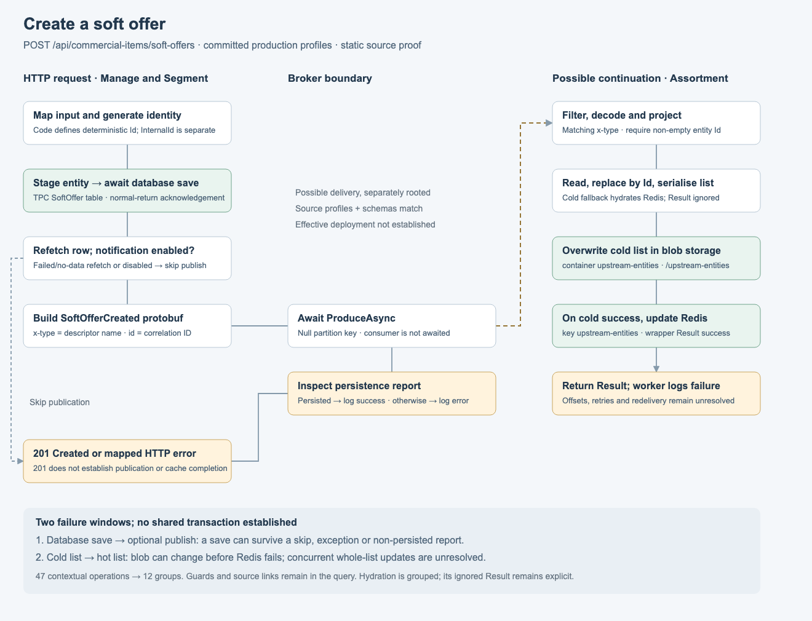
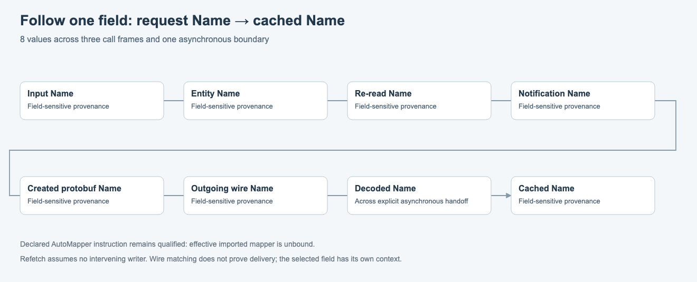

# Soft-offer endpoint knowledge proof

The [v3 runtime walkthrough](../runtime-components.md) now opens this proof on components and interactions.
Select a component for its internal logic or a connection for its contract, schemas and GitHub sources.
Its upgraded inputs are under `runtime/`; the original bundle and manifest below are preserved for replay.
`index.html` is the new landing page; `logic.html` retains the original overview.

The second proof exercises a database write, an optional awaited Kafka publish and a separately rooted
consumer that rewrites cached data. It extends the execution schema to v2. The capture proof remains a v1
fixture and retains its original snapshot and query behaviour. Neither proof migrates the app or workspace.

The endpoint is **POST `/api/commercial-items/soft-offers`**, found through the Volvo map as
`api:mas-soft-offers-create`. The trace uses these pinned sources:

| Role                      | Repository                             | Commit                                     |
| ------------------------- | -------------------------------------- | ------------------------------------------ |
| HTTP request and producer | `volvo-cars/popcat-manage-and-segment` | `b3605063154f542ec1615d363ab858b86c743110` |
| Background consumer       | `volvo-cars/popcat-assortment-api`     | `6114c5db0f2b4b490cf89b9c512088f01dbf0b98` |

`bundle.json` contains 514 typed revision records, including 43 evidence ranges. `source-lock.json` hashes
those exact ranges; `snapshot.json` selects the bundle and `knowledge-query/v2`. The cached commits were
inspected without changing them. This is source evidence, not an assertion about the latest remote branch
or a running deployment. No Volvo endpoint, database, broker or C# test was executed.

## What the endpoint revealed

1. The controller maps the request into a `SoftOffer`. `InternalId` is separate from its deterministic `Id`;
   the latter is generated if missing using the commercial-item type and defining Code.
2. `DbSet.Add` stages a tracked entity and returns a Created result. The service then awaits
   `CompleteAsync`, which awaits `SaveChangesAsync`. Staging is not a persistence acknowledgement.
3. After the save, the service refetches by InternalId. It notifies only when the original result is Created
   with data, the refetch succeeds with data, and notifications are enabled. A failed refetch Result or
   disabled notification can leave the original Created result unchanged.
4. Notification builds `SoftOfferCreated`, serialises raw protobuf and awaits `ProduceAsync`. A `Persisted`
   report is logged as success. Other persistence reports are logged as errors but do not cause a throw in
   this path. A thrown publish exception can escape after the database save.
5. A normal Created path returns 201. It does not require a successful persistence report or consumer
   completion. The inspected database-save/publish path establishes no outbox, shared transaction or
   compensating rollback. That is a scoped source conclusion, not a global absence claim.
6. The consumer filters `x-type`, parses the local protobuf schema and copies Id, Code, Name, SkuCategory
   and SkuIdentifier into `UpstreamEntity`, with empty Tags. This Created handler does not reproject variants;
   the Updated handler is different. SoftOffer Type is not copied into this cache entity.
7. It reads the whole upstream list, preferring Redis and falling back to blob storage. A successful cold
   read attempts to hydrate Redis and **ignores the returned Result** before deserialising. A cold miss
   becomes an empty list; other failed list Results stop mutation.
8. It replaces the entity by Id in the list, serialises the entire list with MessagePack contractless
   resolution and LZ4 block-array compression, overwrites the blob, then updates Redis only if the blob
   wrapper returns a successful Result. Redis failure can follow successful blob overwrite.
9. The callback logs failed Results. Offset commit, redelivery and retry policy remain unresolved in the
   imported consumer wrapper. Entity replacement by Id is not message deduplication or exactly-once
   processing. Concurrent read-modify-write of the whole list is not established as safe.

The protobuf headers and wire tags agree in the inspected sources. The producer's `Prod` and consumer's
`Production` profiles declare the same bootstrap namespace and topic, so the proof groups them under the
analysis label `production-profile`. This match is conditional on those base/profile files being loaded
without relevant overrides. It does not establish the effective deployment or connectivity.

## Schema decisions closed by this case

[The canonical v2 schema](../../../schema/knowledge.schema.json) and generated domain types now carry these
facts natively, rather than burying them in endpoint prose:

| Native record or field | Decision                                                                                                                                                                                                                                                      |
| ---------------------- | ------------------------------------------------------------------------------------------------------------------------------------------------------------------------------------------------------------------------------------------------------------- |
| `storage_write`        | Separate staging, acknowledged operation, insert/replace/upsert mode, field origins, store-call scope and acknowledgement condition. Acknowledgement distinguishes normal return, successful Result and ignored Result. None means a runtime-observed commit. |
| `resource.address`     | Source-declared table, container, blob path, key and connection-setting name, separate from an unresolved physical deployment location.                                                                                                                       |
| `channel_binding`      | Source revision, broker namespace, channel, environment/profile, conditions and gaps. Matching a topic label alone is insufficient.                                                                                                                           |
| `subscription`         | Consumer implementation, channel binding, group, type header/filter, payload and delivery policy.                                                                                                                                                             |
| `handoff`              | Producer publication effect, matching subscription, explicit wire shape and field mappings. Consumer completion is not awaited. Partition key and correlation purpose are separate from entity or message identity.                                           |
| `delivery_policy`      | Awaiting, required broker persistence, offset policy, retry limit, entity replacement keys, ordering and delivery-guarantee uncertainty. Null/unknown is not a default.                                                                                       |
| `consistency_boundary` | Effects, declared order, coordination and the failure window between separate calls. This fixture establishes no shared transaction.                                                                                                                          |
| `milestone`            | Conditional local-save acknowledgement, publication attempt, receipt, persistence report, consumer effect and HTTP response. These are not interchangeable completion states.                                                                                 |
| Stored containers      | Array shapes reference their item shape; the persisted upstream cache is a top-level list, with `[] / Name` as the selected data path, rather than a fictional enclosing object.                                                                              |
| Wire shapes            | Encoding, full wire type, numeric field tags, nested message references, reserved tags/names and completeness. The proof uses conservative exact source-shape matching, not a general protobuf evolution checker.                                             |

Validation checks reference kinds, implementation ownership, producer/subscriber source bindings, key/value
consistency and protobuf tags. A handoff marked `source_matched` must actually match its committed channel,
header, type and closed protobuf shapes. A cross-repository handoff never becomes a synchronous resolution.

The diagram groups the source-local worker callback and its helper path into one consumer implementation.
It does not preserve a distinct call frame for every C# helper. SDK calls and effective mapper semantics
remain explicit knowledge boundaries. The HTTP slice is partial for authentication, validation, shared
middleware and non-Created result statuses; it is not a complete response catalogue.

## Query contracts

Every v2 request pins a snapshot and query rules, an entry, environment profile, node budget and supporting
record budget. Candidate implementations remain excluded. `KnowledgeReader` has indexed operation/effect
lookups for handoff discovery; the UI does not need to scan every record to find a continuation.

| Query                          | Meaning                                                                                                                                                                                                                                        |
| ------------------------------ | ---------------------------------------------------------------------------------------------------------------------------------------------------------------------------------------------------------------------------------------------- |
| `trace`                        | Source-local contextual control graph. The consumer is absent. Unresolved dependencies retain labelled normal **and** exceptional continuations in v2.                                                                                         |
| `continuations`                | Local trace plus possible deliveries to matched subscriptions. Each handoff starts a separate execution context. Consumer returns/exceptions cannot unwind into the producer's HTTP stack. Mismatched or unresolved bindings become frontiers. |
| `consistency`                  | Continuations plus the reachable implementations' write acknowledgements, delivery policies, conditional milestones and failure boundaries. Records preserve their conditions; they are not observed outcomes.                                 |
| `value`                        | Backward field origins through local argument bindings and an explicit handoff context. The cached Name example crosses three calls and one asynchronous boundary. Invalid handoff frames are rejected.                                        |
| `outcome`, `effects`, `impact` | Retain the earlier contracts: local structural HTTP slice, scoped local effects, and invalidation of explanations. Impact does not demonstrate runtime breakage.                                                                               |
| `records`                      | Bounded delivery of typed supporting records and their reference closure. This is a serving contract, not a new source of facts.                                                                                                               |

For example, the cached Name request selects `s2/v/cached-name` with context
`[s2/http.add, s2/add.notify, s2/notify.send, s2/handoff]` and representation `persisted`. The answer reaches
request Name, retains the refetch/no-intervening-writer assumption and exposes the unbound AutoMapper gap.
The schema match establishes a wire contract, not the effective mapper's output or an actual delivery.

`maxNodes` bounds contextual graph expansion. `maxRecords` independently bounds records included in each
response. An incomplete supporting-record closure sets `maxRecords`, leaves `traversalComplete: false` and
returns a validated, snapshot-pinned `nextRequest`. That request carries pending `ids` and `omit` IDs already
loaded by the caller. The union of pages reconstructs the full support closure without duplicate records.
`omit` is client loading state; it is never evidence that an omitted fact was established.

This is **support-record pagination**, not resumable control-graph traversal. Re-run a node-truncated graph
with a larger budget. Response byte/time budgets, compact server cursors and full graph continuations remain
production serving work. Record count does not bound arbitrary record size or wall-clock cost.

All answers keep `feasibility: not_checked` and `exhaustive: false`. A graph traversal finishing does not mean
all system behaviour is known. Guard expressions are preserved descriptions, not a satisfiability solver.

## Run and inspect

```sh
npm run generate:knowledge
npm run proof:soft-offer
npm run proof:soft-offer -- reports/soft-offer-proof/cachedName.request.json
npm run proof:soft-offer:sources -- /path/to/clones
npx vitest run --project unit tools/soft-offer-proof.test.ts tools/async-knowledge.test.ts tools/capture-proof.test.ts tools/knowledge-resolution.test.ts
```

The source check expects `clones/volvo-cars/<repository>` and verifies pinned range digests. It does not prove
that every extraction is correct. The proof command validates both input and output, checks immutable
snapshot membership, and builds a disposable SQLite projection. Rebuilding it produces identical answers.

Generated files are under `reports/soft-offer-proof/`: nine request/result pairs, `index.sqlite`, `index.html`
and two SVG projections. Requests include a wrong environment, a bounded support page, a consumer-schema
invalidation query, local/extended traces, consistency, 201/500 slices and the cached Name journey.

The screenshots below were rendered and inspected at 1320 pixels wide. The main drawing groups 47
contextual operations into 12 readable groups. The separate data drawing has eight values. Automated bounds
checks found no text overflow. The grouping is presentation configuration, not canonical data. These are
static proof views, not a new app route or a general interactive explorer.

## Before app migration

The v2 execution schema and the query distinctions above are the migration target for the two tested cases.
The production YAML reader and workspace remain unchanged. Keep these acceptance fixtures through migration:

- Capture's v1 bundle, manifest and existing rule behaviour replay unchanged.
- Source-local tracing and asynchronous continuation tracing remain separate choices.
- A 201, broker report and consumer acknowledgement remain distinct in both UI and agent answers.
- Field provenance, declared addresses, evidence, coverage and gaps survive every projection.
- Unsafe joins fail at validation and become visible frontiers during defensive query evaluation.
- SQLite can be discarded and rebuilt; failed input cannot replace a published snapshot.

The remaining **source facts** are explicit gaps: effective deployment/configuration, exact Kafka/mapper
library behaviour, offsets/retries, concurrency protection and wider middleware coverage. They do not
require inventing another endpoint narrative or silently filling defaults.

The remaining **adoption work** is separate: ingestion replacement/deletion/merge and interpretation-bundle
contracts; component and logical-identity reconciliation; discovery/comparison contracts; byte/time limits
and graph continuation; and scale tests with shared hubs and fan-out. These two correctness fixtures do not
establish enterprise performance or finish the whole company model. Do not migrate by treating the proof's
SQLite layout, diagram grouping or two endpoint slices as the complete enterprise schema.

## Captured views




